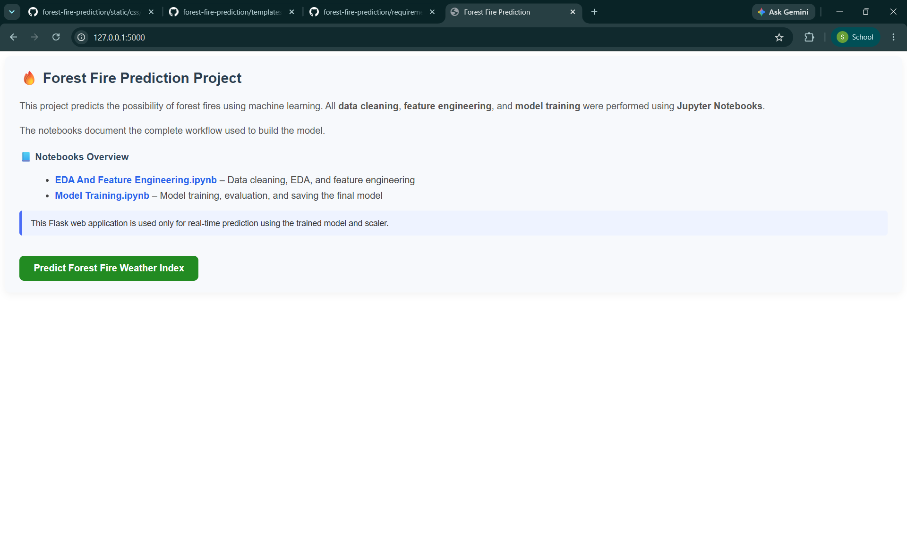
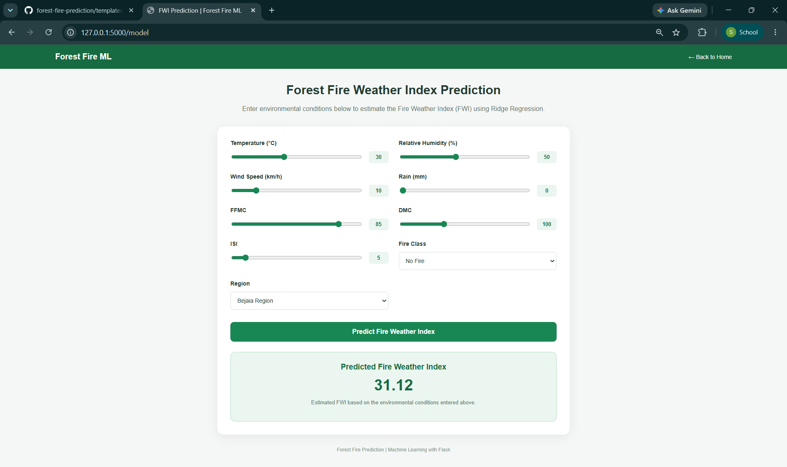
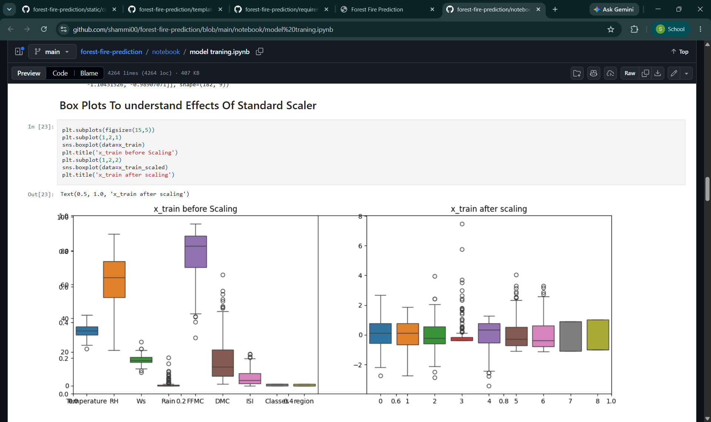
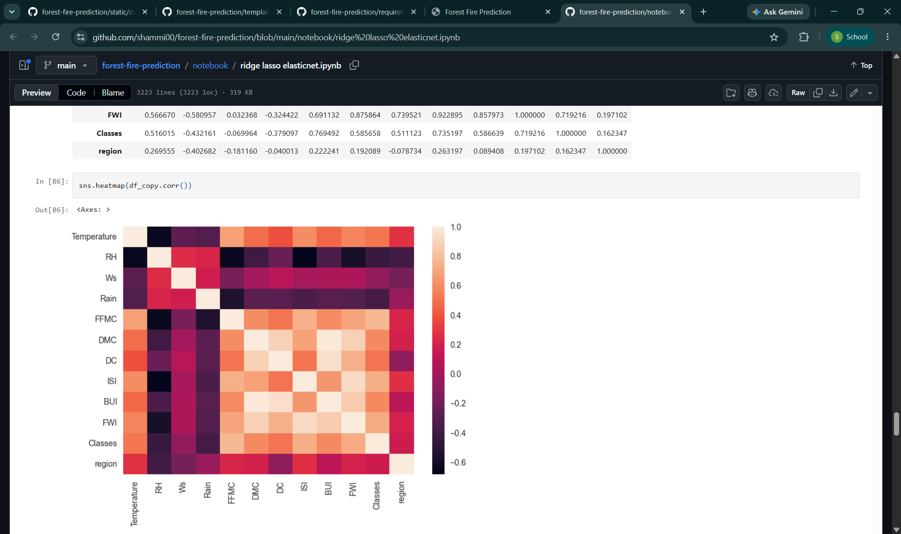
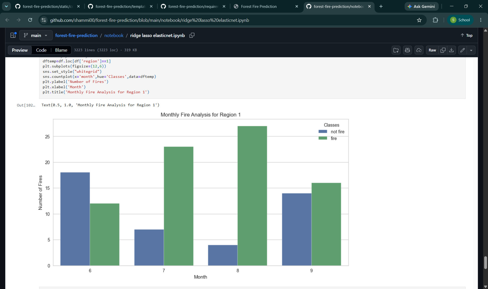

# 🔥 Forest Fire Weather Index Prediction using Machine Learning

An end-to-end machine learning project that predicts the **Fire Weather Index (FWI)** using environmental and meteorological features from the Algerian Forest Fires dataset.

The project includes exploratory data analysis, data preprocessing, feature scaling, regression model development, and a Flask web application for interactive predictions.

## 📌 Project Overview

The Fire Weather Index (FWI) is an indicator used to assess weather-related fire danger.

This project uses a **Ridge Regression** model to estimate FWI based on nine input features. A Flask application allows users to adjust environmental conditions and obtain predictions through a web interface.

**Note:** This is an FWI regression application, not a direct fire-occurrence classifier or an operational wildfire warning system.

## 🛠️ Technologies Used

- Python
- Pandas and NumPy
- Scikit-learn
- Matplotlib and Seaborn
- Flask
- HTML and CSS
- Jupyter Notebook
- Pickle

## 📊 Dataset

The project uses the **Algerian Forest Fires dataset**, which contains meteorological and fire-related observations from two regions of Algeria.

The repository includes the original and cleaned datasets in the `dataset/` folder.

### Model Input Features

1. **Temperature:** Air temperature in °C
2. **RH:** Relative humidity
3. **Ws:** Wind speed
4. **Rain:** Rainfall
5. **FFMC:** Fine Fuel Moisture Code
6. **DMC:** Duff Moisture Code
7. **ISI:** Initial Spread Index
8. **Classes:** Fire or no-fire category
9. **Region:** Algerian geographical region

**Target variable:** Fire Weather Index (FWI)

## 🔄 Machine Learning Workflow

### 1. Data Cleaning and Preprocessing
- Explore the Algerian Forest Fires dataset
- Clean and prepare the data
- Handle data types and categorical variables
- Prepare the input features and target variable

### 2. Exploratory Data Analysis
- Analyze relationships between meteorological features
- Examine correlations using a heatmap
- Visualize monthly fire and no-fire observations
- Explore feature distributions

### 3. Feature Scaling
- Apply StandardScaler to the training features
- Examine feature distributions before and after scaling
- Save the fitted scaler for use during inference

### 4. Model Development
- Explore regression techniques in Jupyter notebooks
- Study Ridge, Lasso, and Elastic Net regression
- Use a trained Ridge Regression model for application predictions
- Save the model using Pickle

### 5. Flask Web Application
- Load the saved model and scaler
- Collect user inputs through an interactive form
- Apply feature scaling
- Generate an FWI prediction
- Display the result in a responsive web interface

## 🖥️ Application Screenshots

### Homepage

The homepage introduces the project and provides access to the prediction interface.



### FWI Prediction Interface

Users can adjust environmental inputs using sliders and dropdowns. The trained model then estimates the Fire Weather Index.



## 📈 Data Analysis and Preprocessing

### Feature Scaling

Comparison of feature distributions before and after applying StandardScaler.



### Correlation Heatmap

Visualization of correlations between the dataset's numerical variables.



### Monthly Fire Analysis

Comparison of fire and no-fire observations across months for one of the dataset regions.



## 📂 Project Structure

```text
forest-fire-prediction/
├── application.py
├── requirements.txt
├── README.md
├── .gitignore
├── .ebextensions/
│   └── python.config
├── dataset/
│   ├── Algerian_forest_fires_dataset_UPDATE.csv
│   └── algerian_forest_fires_cleaned.csv
├── model/
│   ├── ridge.pkl
│   └── scaler.pkl
├── notebook/
│   ├── model traning.ipynb
│   └── ridge lasso elasticnet.ipynb
├── templates/
│   ├── home.html
│   └── model.html
├── static/
│   └── css/
│       └── style.css
└── screenshots/
    ├── homepage.png
    ├── fwi_prediction.png
    ├── feature_scaling.png
    ├── correlation_heatmap.png
    └── monthly_fire_analysis.png
```

## 🚀 Installation and Setup

### 1. Clone the Repository

```bash
git clone https://github.com/shammi00/forest-fire-prediction.git
cd forest-fire-prediction
```

### 2. Create a Virtual Environment

```bash
python -m venv venv
```

Activate the environment on Windows CMD:

```cmd
venv\Scripts\activate
```

### 3. Install Dependencies

```bash
pip install -r requirements.txt
```

### 4. Run the Flask Application

```bash
python application.py
```

### 5. Open the Application

Visit:

`http://127.0.0.1:5000/`

Click **Predict Forest Fire Weather Index** to open the prediction interface.

## 🧪 Example Prediction

The application was tested locally using the following inputs:

| Feature | Value |
|---|---|
| Temperature | 30 °C |
| Relative Humidity | 50% |
| Wind Speed | 10 km/h |
| Rain | 0 mm |
| FFMC | 85 |
| DMC | 100 |
| ISI | 5 |
| Fire Class | No Fire |
| Region | Bejaia |

**Example predicted FWI: 31.12**

This is a sample model output, not a measurement of model accuracy.

## 📚 Jupyter Notebooks

The repository contains notebooks documenting the exploratory analysis, preprocessing, regression experiments, model training, and evaluation.

- [Model Training Notebook](notebook/model%20traning.ipynb)
- [Ridge, Lasso and Elastic Net Notebook](notebook/ridge%20lasso%20elasticnet.ipynb)

## 🔮 Future Improvements

- Add automated input validation and error handling
- Improve testing and dependency reproducibility
- Display documented model evaluation metrics
- Explore additional regression algorithms
- Deploy the application to a cloud hosting platform
- Add automated testing and CI/CD

## 👨‍💻 Author

**Shammi Kumar Singh**

B.Tech Computer Science — Artificial Intelligence & Machine Learning

[GitHub Profile](https://github.com/shammi00)

[LinkedIn Profile](https://www.linkedin.com/in/shammikumarsingh)

---

⭐ If you find this project useful, consider starring the repository.
